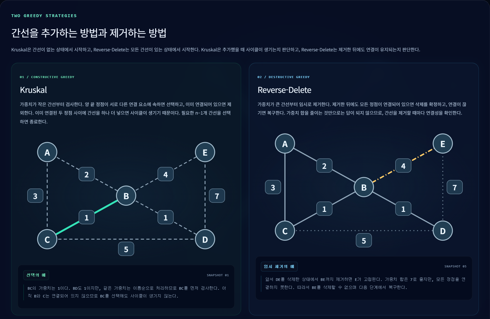
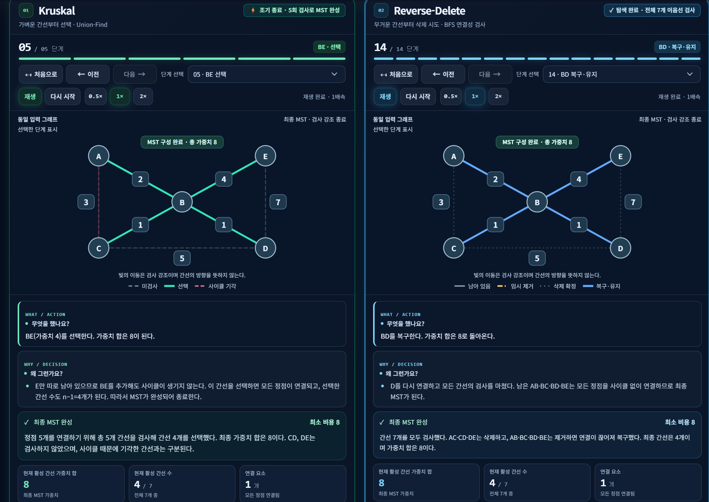

<div align="center">

# Kruskal vs. Reverse-Delete — MST Algorithm Visualization

**최소 신장 트리(MST)를 푸는 상향식(간선 추가) · 하향식(간선 삭제) 두 탐욕 알고리즘의 내부 동작과 비용 비교**

[](https://algorithm-visualization-snowy.vercel.app)
[](#6-아키텍처-및-검증)
[](#6-아키텍처-및-검증)


[Live Demo](https://algorithm-visualization-snowy.vercel.app) ·
[전략 비교](#1-알고리즘-전략-비교) ·
[실행 분석](#3-주요-분기-및-실행-요약) ·
[의사코드](#4-핵심-의사코드) ·
[복잡도 분석](#5-시간공간-복잡도-분석) ·
[로컬 실행](#7-로컬-실행-및-검증)

</div>

---

동일한 무방향 가중치 그래프 위에서 **Kruskal(간선 추가)**과 **Reverse-Delete(간선 삭제)**가 어떤 순서로 간선을 검사하고, 각 단계에서 **무엇을 왜 선택·기각·삭제·복구하는지** 나란히 추적할 수 있는 인터랙티브 웹 시각화 프로젝트입니다.

<p align="center">
  
</p>

> **핵심 비교 요약 (5정점 · 7간선 공통 입력):** 두 알고리즘 모두 동일한 MST `{AB, BC, BD, BE}` (총 가중치 **8**)를 찾지만, **Kruskal**은 `n - 1 = 4`개 간선을 고른 뒤 **5회 검사(6스냅샷)** 만에 조기 종료하고, BFS 기반 **Reverse-Delete**는 정점 고립 여부를 검증하며 **7개 전체 검사(15스냅샷)** 를 수행합니다. *(검사 횟수와 스냅샷 수는 알고리즘 동작 구조의 차이이며, 실행 시간 벤치마크 수치가 아닙니다.)*

---

## 1. 알고리즘 전략 비교

최소 신장 트리(MST)는 연결된 무방향 가중치 그래프에서 **(a) 모든 정점을 연결**하고 **(b) 사이클이 없으며** 간선 가중치 합이 최소인 트리입니다. 두 알고리즘은 같은 탐욕 3단계(선정 → 적정성 점검 → 해답 점검)를 따르지만 정반대 방향으로 해를 구성합니다.

| 구분 | Kruskal (상향식 · 간선 추가) | Reverse-Delete (하향식 · 간선 삭제) |
|---|---|---|
| **시작 상태** | 선택한 간선이 없는 상태 (`n`개 독립 연결 요소) | 모든 `m`개 간선이 포함된 연결 그래프 (`1`개 연결 요소) |
| **간선 정렬 순서** | 가중치 오름차순 (동률 시 이름·ID 오름차순) | 가중치 내림차순 (동률 시 이름·ID 오름차순) |
| **적정성 점검 기준** | 양 끝 정점이 서로 다른 집합인지 확인 (사이클 차단) | 간선 임시 제거 후 연결 요소가 `1`개인지 확인 (고립 차단) |
| **사용 자료구조** | 서로소 집합 (`UnionFind`: 경로 압축 + 랭크 기반 합치기) | 인접 리스트 + BFS 연결 요소 탐색 |
| **종료 조건** | `n - 1`개 간선 선택 시 즉시 종료 | 정렬된 `m`개 간선 전체 검사 후 종료 |

---

## 2. 공통 입력 그래프 및 결정성 규칙

두 전략의 핵심 분기(사이클 기각 vs. 우회로 삭제 vs. 정점 고립 복구)를 한 그래프에서 대조하기 위해 [fixtures.ts](src/algorithms/fixtures.ts)에 정의된 **5정점(`A, B, C, D, E`) · 7간선** 무방향 연결 그래프(초기 가중치 합 `23`)를 사용했습니다.

| 간선 | 가중치 | 두 알고리즘에서의 관찰 포인트 |
|---:|---:|---|
| `BC`, `BD` | `1`, `1` | 가중치 동률 간선. 이름순(`BC → BD`)으로 Kruskal 초반 선택, Reverse-Delete 마지막 고립 확인 대상 |
| `AB` | `2` | Kruskal 3번째 선택(`A–B–C–D` 연결) / Reverse-Delete에서는 `AC` 삭제 후 `A` 고립 때문에 복구 |
| `AC` | `3` | **분기 ①:** Kruskal에서는 `A–B–C–A` 사이클로 **기각**, Reverse-Delete에서는 우회 경로(`A–B–C`)로 **삭제 확정** |
| `BE` | `4` | **분기 ②:** Reverse-Delete에서 `DE` 삭제 후 빼면 **`E`가 고립**되어 **복구** / Kruskal에서는 4번째로 선택 후 **조기 종료** |
| `CD`, `DE` | `5`, `7` | Reverse-Delete 초반에 우회 경로로 **삭제 확정** / Kruskal은 이미 `n - 1 = 4`개를 채워 **미검사 종료** |

- **결정적(Deterministic) 실행:** 동률 간선은 정규화된 이름·ID 오름차순으로 정렬하며, 매 단계 스냅샷(`MstRun.snapshots`)을 `Object.freeze` 불변 객체로 기록해 어느 단계로 이동해도 동일한 그래프·수치·설명을 재현합니다.

---

## 3. 주요 분기 및 실행 요약

<p align="center">
  
</p>

1. **Kruskal 4단계 — `AC(3)` 사이클 기각:** `BC(1) → BD(1) → AB(2)` 선택으로 이미 `A–B–C`가 연결되어 있으므로, `BE(4)`보다 가벼운 `AC`라도 추가하면 사이클이 생겨 기각하고 합 `4`를 유지합니다.
2. **Kruskal 5단계 — `BE(4)` 선택 및 조기 종료:** `E`까지 연결해 `n - 1 = 4`개 간선(합 `8`)을 채우자마자 `CD(5)`와 `DE(7)`은 검사하지 않고 종료합니다.
3. **Reverse-Delete 5~6단계 — `BE(4)` 임시 제거와 복구:** `DE(7)`, `CD(5)`를 지운 상태에서 `BE`를 빼면 활성 합이 `7`로 줄어 보이지만 연결 요소가 `{A, B, C, D}`와 `{E}`로 쪼개집니다. `BFS`로 고립을 감지해 6단계에서 `BE`를 복구(합 `11`)한 뒤 남은 간선 검사를 이어 갑니다.

| 비교 항목 | Kruskal | Reverse-Delete |
|---|---|---|
| **최종 MST / 가중치 합** | `AB, BC, BD, BE` / **8** | `AB, BC, BD, BE` / **8** |
| **검사한 간선 수** | **5회** (`CD, DE` 미검사) | **7회** (`m`개 전체 검사) |
| **처리 결과 요약** | 4개 선택, 1개(`AC`) 기각, 2개 미검사 | 3개(`DE, CD, AC`) 삭제, 4개(`BE, AB, BC, BD`) 복구·유지 |
| **기록된 스냅샷 수** | **6개** (`0~5단계`) | **15개** (`0~14단계`, 임시 제거·판정 분리 기록) |

> 전체 6단계 · 15단계 스냅샷별 활성 간선과 가중치 변화표는 [전체 실행 기록](docs/mst-core.md#과제-그래프의-실행-기록)에서 확인할 수 있습니다.

---

## 4. 핵심 의사코드

웹앱 내 이론 비교 탭과 동일한 알고리즘 구조를 간결하게 정리한 핵심 로직입니다. (세부 입력 검증, 스냅샷 불변 계약, 서로소 집합 `initialize/find/equal/merge` 전개는 [의사코드 상세 문서](docs/mst-lecture.md#의사코드)에 정리되어 있습니다.)

```cpp
void kruskal(int n, int m, set_of_edges E, set_of_edges& F) {
  index i, j;
  set_pointer p, q;
  edge e;
  Sort the m edges in E by weight in nondecreasing order; // tie-break: name asc
  F = ∅;
  initial(n);
  while (number of edges in F is less than n - 1) {
    e = next lightest edge in E;
    i, j = indices of vertices connected by e;
    p = find(i);
    q = find(j);
    if (!equal(p, q)) {
      merge(p, q);
      add e to F;
    }
  }
}

void reverse_delete(int n, int m, set_of_edges E, set_of_edges& F) {
  edge e;
  Sort the m edges in E by weight in nonincreasing order; // tie-break: name asc
  F = E;
  for each edge e in sorted E {
    remove e from F;
    if (!is_connected(n, F)) // BFS로 연결 요소 수가 1인지 확인
      add e to F;
  }
}
```

---

## 5. 시간·공간 복잡도 분석

정점 수 `n`, 간선 수 `m`, 로그 밑 `2`(`lg`) 기준, **시각화 스냅샷 기록을 제외한 핵심 알고리즘의 최악 시간·공간 복잡도**입니다.

| 비교 항목 | Kruskal (`UnionFind`) | Reverse-Delete (현재 BFS 기반) |
|---|---|---|
| **핵심 최악 시간 `W(m, n)`** | `Θ(m lg m)` | `Θ(m(n + m)) = Θ(mn + m²)` |
| **시간을 지배하는 연산** | 간선 정렬 `Θ(m lg m)` (집합 연산 흡수) | `m`회 반복되는 인접 리스트 구성 + `BFS` (`Θ(n + mₐ)`) |
| **희소 그래프 (`m ≈ n`)** | `Θ(n lg n)` | `Θ(n²)` |
| **완전 그래프 (`m ∈ Θ(n²)`)** | `Θ(n² lg n)` | `Θ(n⁴)` |
| **핵심 추가 작업 공간** | `Θ(n + m)` *(집합 자료구조 자체는 `Θ(n)`)* | `Θ(n + m)` *(인접 리스트 · 방문 배열 포함)* |
| **전체 스냅샷 저장 공간** | `Θ(Sₖ(n + m))` | `Θ(Sᵣ(n + m))` |

- **Kruskal의 집합 연산 비용:** [unionFind.ts](src/algorithms/unionFind.ts)는 경로 압축과 랭크 기반 합치기를 함께 사용해, 연속 연산의 상각 비용이 역 아커만 함수 `α(n)`에 비례하므로 전체 실행 시간이 정렬 비용 `Θ(m lg m)`에 흡수됩니다.
- **Reverse-Delete의 탐색 비용과 범위:** 현재 구현은 매 단계 남은 간선 `mₐ`개로 인접 리스트를 구성하고 BFS를 수행하므로 한 단계 `Θ(n + mₐ)`, 최악 총량 `Θ(m(n + m))`이 됩니다. 이는 현재 BFS 구현에 대한 분석이며, 고급 동적 연결성 자료구조를 쓰는 변형 구현까지 같은 비용이라고 일반화하지 않습니다.
- **기록 공간 분리:** `Sₖ`, `Sᵣ`는 각 알고리즘의 스냅샷 수입니다. 시각화 UI 재생을 위해 매 단계 상태를 불변 복사해 남기는 비용은 핵심 알고리즘의 공간 복잡도와 분리해 해석합니다. 상세 유도는 [복잡도 분석 문서](docs/mst-lecture.md#표기와-분석-범위)에 있습니다.

---

## 6. 아키텍처 및 검증

알고리즘 코어는 React · SVG · GSAP과 완전히 분리된 순수 TypeScript 모듈로 동작하며, UI 컴포넌트는 계산된 불변 `Snapshot`을 읽기만 합니다.

| 디렉터리 / 문서 | 역할 |
|---|---|
| [src/algorithms](src/algorithms) | 그래프 검증·정규화, `UnionFind`, `Kruskal`, `Reverse-Delete`, BFS 연결 요소, 불변 스냅샷 생성 |
| [src/animation](src/animation) | 패널별 독립 재생 타임라인, `0.5x / 1x / 2x` 배속, Reduced Motion 대응 및 GSAP 연출 |
| [src/components](src/components) | 개념 비교 섹션, 인터랙티브 Algorithm Lab, 요약 비교표, 이론 비교 탭, 참고자료 섹션 |
| [docs/mst-core.md](docs/mst-core.md) | 알고리즘 모듈 API 계약, 오류 코드, 결정성 규칙 및 과제 그래프 전체 스냅샷 기록 |
| [docs/mst-lecture.md](docs/mst-lecture.md) | 문제 정의·입출력 계약, 순수 의사코드, 점근 표기 및 복잡도 유도 노트 |
| [docs/algorithm-references.md](docs/algorithm-references.md) | 출처별 확인 범위와 자체 분석 근거 구분 기록 |

### 자동 검증 결과 (`2026-11-14` 기준)

| 항목 | 명령어 | 확인 결과 |
|---|---|---|
| **단위 · 통합 · UI 테스트** | `npm test` (`vitest run`) | **22개 테스트 파일, 300개 테스트 PASS** |
| **타입 체크 · 프로덕션 빌드** | `npm run build` (`tsc -b && vite build`) | **오류 0건** (`dist` 번들 정상 생성) |
| **정적 린트 검사** | `npm run lint` (`oxlint`) | **54개 파일, 0 warnings · 0 errors** |
| **CI 워크플로** | [.github/workflows/ci.yml](.github/workflows/ci.yml) | Node.js 24에서 `npm ci → test → build → lint` 정의 |

---

## 7. 로컬 실행 및 검증

[package.json](package.json) 기준 지원 Node.js 범위는 `^22.22.2 || ^24.15.0 || >=26.0.0`입니다.

```bash
npm ci
npm run dev
```

전체 테스트, 빌드, 린트를 한 번에 검증하려면 아래 명령을 실행합니다. *(Windows PowerShell 실행 정책 제한 시 `npm` 대신 `npm.cmd`를 사용하세요.)*

```bash
npm test
npm run build
npm run lint
```

---

## 8. 참고문헌

- 수업 강의자료 `algo4.pdf` / `algo4-강의용-part-1.pdf` — *Chap. 4 The Greedy Approach* (탐욕 기법 3단계, 트리 조건, Kruskal `find/equal/merge`·경로 압축/랭크·최악 시간 분석)
- Robert Sedgewick & Kevin Wayne, *Algorithms*, 4th ed. — [§4.3 Minimum Spanning Trees](https://algs4.cs.princeton.edu/43mst/index.php), [§1.5 Union-Find](https://algs4.cs.princeton.edu/15uf/)
- Princeton University, *COS 423: Greedy Algorithms II*, Spring 2013, [Slide 34](https://www.cs.princeton.edu/courses/archive/spring13/cos423/lectures/04GreedyAlgorithmsII.pdf) (Reverse-Delete 원리 및 정당성)
- KOCW 공개 강의자료 — [「그래프 순회 및 최소비용 신장트리」](https://contents.kocw.net/document/8th_Traversal_MCSP.pdf)
- 세부 출처별 인용 범위와 자체 검증 구분은 [docs/algorithm-references.md](docs/algorithm-references.md)에서 확인할 수 있습니다.
